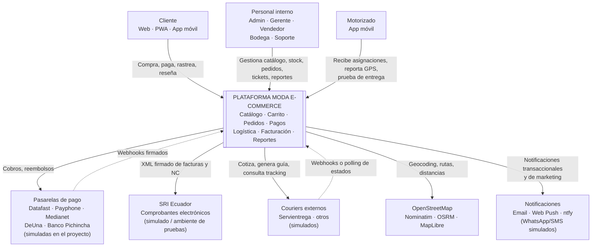
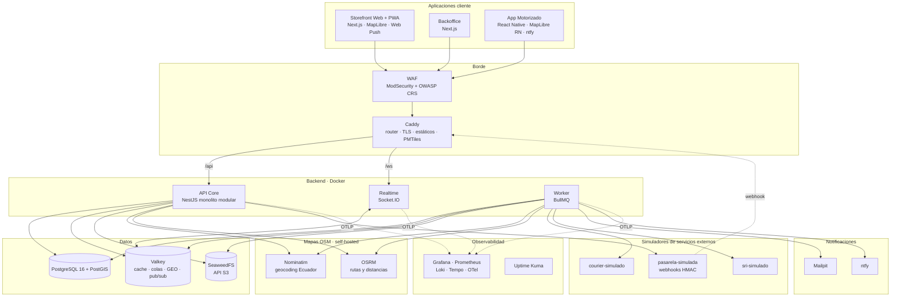
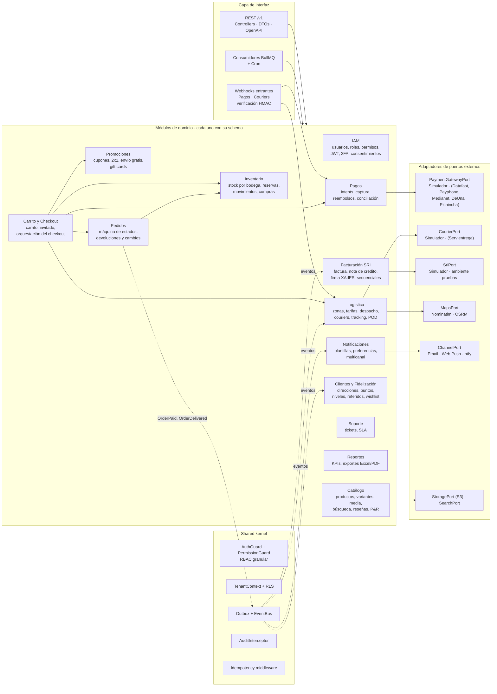
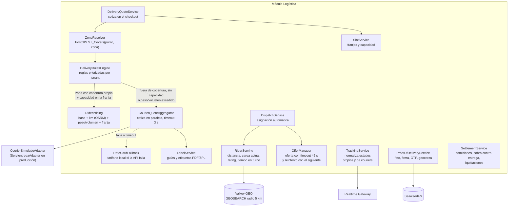

# Entregable 1 — Arquitectura de alto nivel (C4)

> Versión revisada: stack 100 % open source y sin costo. Los servicios comerciales se reemplazan por simuladores detrás de puertos.

## 1.0 Decisiones arquitectónicas base (ADR resumidos)

| # | Decisión | Elección | Motivo |
|---|---|---|---|
| ADR-01 | Estilo arquitectónico | **Monolito modular** con arquitectura hexagonal por módulo | Con 2-3 devs y 8-12 semanas, los microservicios multiplican el costo operativo. Los límites estrictos entre módulos permiten extraer servicios después sin reescribir. |
| ADR-02 | Lenguaje | **TypeScript end-to-end** | Un solo lenguaje para storefront, backoffice, app de motorizado y backend. Mucho talento disponible en LATAM. |
| ADR-03 | Framework backend | **NestJS** | Módulos, inyección de dependencias, guards, colas y WebSockets. Encaja con un monolito modular. |
| ADR-04 | Base de datos | **PostgreSQL 16 + PostGIS**, un *schema* por módulo | ACID para stock, pedidos y pagos. PostGIS para zonas de cobertura y cercanía. `jsonb` donde hace falta flexibilidad. |
| ADR-05 | Comunicación entre módulos | Síncrona mediante la **API pública del módulo**. Asíncrona mediante **eventos de dominio con Transactional Outbox** | Evita joins entre módulos y garantiza que ningún evento se pierda. |
| ADR-06 | Procesamiento asíncrono | **Worker** (mismo código, otro proceso) con **BullMQ sobre Valkey** | Aísla integraciones lentas (SRI, couriers, notificaciones) del checkout. Reintentos, backoff, trabajos diferidos y cron nativos. |
| ADR-07 | Tiempo real | Gateway **Socket.IO con adaptador Valkey** | Tracking en vivo y estados del pedido. Primer candidato a extraerse como servicio. |
| ADR-08 | Infraestructura | **Docker Compose self-hosted** (opcional k3s) | Restricción del proyecto: open source y sin costo. |
| ADR-09 | Multi-tenant | `tenant_id` en agregados raíz + **Row Level Security** activable | Costo casi nulo hoy; habilita futuras marcas sin migración. |
| ADR-10 | Servicios externos | **Simuladores** (pagos, SRI, couriers) con webhooks firmados HMAC | No existen equivalentes open source; demuestra la arquitectura hexagonal. |

## 1.1 Nivel 1 — Diagrama de contexto



- **Actores humanos:** 7 roles con permisos distintos sobre la misma plataforma. El courier externo (rol 8) se integra como sistema.
- **Críticas para el checkout:** pagos y mapas.
- **No bloquean el checkout:** SRI, couriers y notificaciones (asíncronos con reintentos). Si el SRI no responde, la venta se concreta y la factura se autoriza después.

## 1.2 Nivel 2 — Diagrama de contenedores



| Contenedor | Tecnología | Responsabilidad | Escalado |
|---|---|---|---|
| Storefront Web/PWA | Next.js | Catálogo con SSR/ISR para SEO, carrito, checkout, tracking, cuenta. Instalable como PWA. | Horizontal. |
| Backoffice | Next.js | CRUD, dashboards, bodega (picking, escaneo), tickets. Menú según permisos. | Estático. |
| App Motorizado | React Native + Expo | Turnos, ofertas de pedido, navegación, GPS cada 10-15 s, foto, firma, OTP, cobro contra entrega. | — |
| API Core | NestJS | Toda la lógica de negocio. Sin estado en memoria. | Horizontal (réplicas detrás de Caddy). |
| Realtime | NestJS + Socket.IO | Canales `order:{id}` y `rider:{id}`. | Horizontal con adaptador Valkey. |
| Worker | NestJS + BullMQ | Colas, cron (carrito abandonado, franjas, conciliación, liquidaciones), relay del outbox. | Por profundidad de cola. |
| PostgreSQL | PostGIS 16 | Fuente de verdad. | Vertical; réplica de streaming opcional para reportes. |
| Valkey | Valkey 8 | Cache, colas BullMQ, rate limiting, `GEOADD` de motorizados, locks, pub/sub. | Réplica/cluster en V2. |
| SeaweedFS | API S3 | Imágenes, videos, modelos AR, XML y PDF del SRI, pruebas de entrega. | Volúmenes adicionales. |
| Nominatim / OSRM | OSM Ecuador | Geocoding de direcciones; distancia real por calle y ETA. | — |
| Simuladores | NestJS/Node | Imitan pasarelas, SRI y couriers con webhooks firmados. | — |

**Búsqueda:** en el MVP, Full-Text Search de PostgreSQL (`tsvector` con diccionario `spanish` + `pg_trgm`). En V2, Meilisearch detrás del `SearchPort`.

## 1.3 Nivel 3 — Componentes del API Core



### Detalle del módulo Logística



### Estructura del código

```text
apps/
  api/            # bootstrap HTTP
  worker/         # bootstrap de consumidores BullMQ y cron
  realtime/       # bootstrap WebSocket
libs/
  modules/
    catalog/
      api/             # controllers + DTOs
      application/     # casos de uso
      domain/          # entidades, value objects, eventos, reglas
      infrastructure/  # repositorios, adaptadores
      catalog.module.ts
      index.ts         # API PÚBLICA del módulo
    inventory/ ... logistics/ ... billing/ ...
  shared-kernel/  # auth, tenancy, outbox, audit, idempotency, errores
  adapters/       # payments/, couriers/, sri/, maps/, channels/
simulators/
  payments/  courier/  sri/
```

### Reglas de modularidad (verificadas en CI con dependency-cruiser)

1. Un módulo solo importa el `index.ts` de otro módulo. Excepción: `events.ts`, los contratos de eventos (nombres y payloads, sin Nest ni base), para que dos módulos se suscriban a los eventos del otro sin ciclos de imports. Las reglas se revisan con `npm run arch:check` y `npm run arch:schemas` (ver `08-despliegue.md`, 8.3).
2. Un módulo solo accede a **su propio schema**. Sin joins entre schemas, salvo Reportes.
3. Efectos secundarios entre módulos **por eventos**, no por llamadas directas.
4. Cada adaptador externo implementa un *port*. Cambiar el simulador por el proveedor real = una clase nueva.

Candidatos a extraerse como servicios en V2/V3: **Tracking/Realtime**, **Notificaciones**, **Búsqueda**, **Facturación SRI**.

### Eventos de dominio principales

| Evento | Productor | Consumidores |
|---|---|---|
| `OrderPlaced` | Pedidos | Inventario, Notificaciones, Logística (si es contra entrega) |
| `PaymentCaptured` / `PaymentFailed` | Pagos | Pedidos, Notificaciones |
| `OrderPaid` | Pedidos | Facturación SRI, Logística, Fidelización |
| `ShipmentAssigned` / `ShipmentStatusChanged` | Logística | Pedidos, Notificaciones, Realtime. Hoy `ShipmentStatusChanged` se emite al cancelar envíos pendientes y al recibir un retiro en bodega; el despacho lo emitirá con el mismo contrato |
| `OrderDelivered` | Pedidos | Fidelización, Liquidaciones, solicitud de reseña |
| `ReturnRequested` · `ReturnApproved` · `ReturnReceived` · `ReturnInspected` · `ReturnRefunded` · `ReturnExchanged` | Pedidos | Notificaciones. El retiro (Logística), el stock (Inventario) y el reembolso (Pagos) los compone el orquestador de posventa en la misma transacción que cada paso, como Checkout |
| `RefundSucceeded` / `RefundFailed` | Pagos | Pedidos (devolución y pedido reembolsados), Facturación SRI (nota de crédito), Notificaciones |
| `InvoiceAuthorized` / `InvoiceRejected` | Facturación | Notificaciones, Soporte (`InvoiceRejected` abre un ticket interno) |
| `StockBelowThreshold` | Inventario | Notificaciones, Compras |
| `CartAbandoned` | Carrito (cron) | Notificaciones (1 h, 24 h, 72 h; marketing: exige consentimiento en `iam.consents`) |
| `TicketCreated` · `TicketReplied` · `TicketClosed` | Soporte | Notificaciones (acuse, respuesta del agente y encuesta CSAT por email, con un enlace firmado al ticket) |
| `TicketSlaBreached` | Soporte (cron) | Notificaciones (alerta ntfy al backoffice) |
